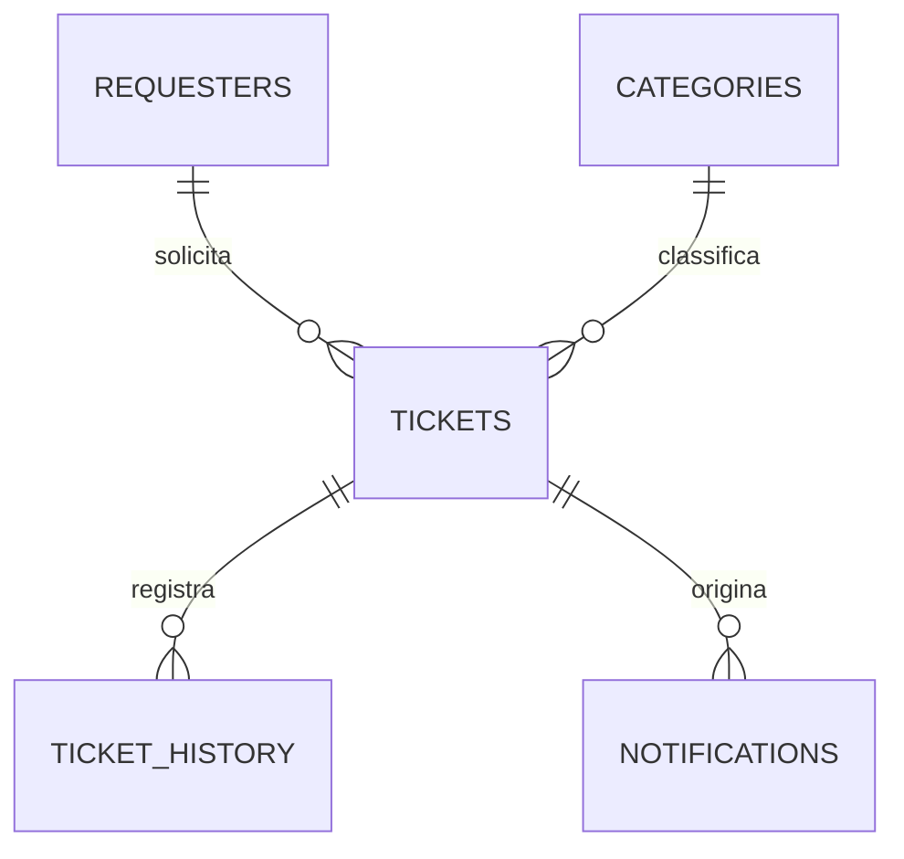

# HelpDesk Hub — Central Inteligente de Chamados de TI

Projeto final da disciplina C216 — Sistemas Distribuídos. A proposta é centralizar o registro de solicitações de suporte de TI. Em etapas futuras, a abertura de um chamado poderá disparar notificações por e-mail e Microsoft Teams.

A Etapa 3 disponibiliza a API de solicitantes, categorias, chamados e indicadores. A API usa o modelo relacional da revisão `0001_helpdesk`. A abertura de um chamado prepara duas entregas pendentes para a equipe de TI. O envio está previsto para a Etapa 4.

## Executar com Docker no PowerShell

Use Docker Desktop em modo de containers Linux, com Docker Compose v2 ou superior. Na raiz do repositório:

```powershell
if (!(Test-Path .env)) { Copy-Item .env.example .env }
docker compose up -d --build --wait
docker compose ps
Invoke-RestMethod http://127.0.0.1:8001/health
```

| Serviço | Endereço padrão | O que verificar |
| --- | --- | --- |
| React | [Página inicial](http://127.0.0.1:5180) | Nome HelpDesk Hub e descrição da central |
| FastAPI | [GET /health](http://127.0.0.1:8001/health) | HTTP 200 com `{"status":"ok"}`, que indica que a API responde |
| OpenAPI | [Documentação interativa](http://127.0.0.1:8001/docs) | Endpoints, parâmetros e exemplos de requisições e respostas |
| PostgreSQL 16 | `127.0.0.1:5433` | Banco `helpdesk` com os valores de exemplo |

O Compose usa o nome de projeto `helpdesk-hub` e o volume `db_data` desse projeto. O banco sinaliza prontidão com `pg_isready`. A API conecta-se a `db:5432` e executa `alembic upgrade head` antes de iniciar o Uvicorn. O Nginx serve os arquivos estáticos gerados pelo Vite.

Para parar a aplicação preservando o volume, execute `docker compose down`.

## API de chamados

| Recurso | Operações |
| --- | --- |
| `/requesters`, `/categories` | `POST` cadastra e `GET` pesquisa. Em `/{id}`, use `GET` para consultar, `PUT` para substituir e `DELETE` para excluir um registro sem chamados vinculados. |
| `/tickets` | `POST` abre um chamado em `OPEN` e `GET` lista os resultados filtrados. |
| `/tickets/{id}` | `GET` consulta, `PUT` substitui os campos operacionais de um chamado ativo e `DELETE` exclui fisicamente um chamado cancelado, incluindo seu histórico e suas notificações. |
| `/tickets/{id}/status` | `PATCH` aplica uma transição de status. |
| `/tickets/{id}/history`, `/tickets/{id}/notifications` | `GET` consulta o histórico cronológico ou as entregas daquele chamado. |
| `/dashboard` | `GET` retorna totais por status, prioridade e categoria, críticos ativos, média de resolução em segundos, os cinco chamados mais recentes e totais por status de notificação. Em banco vazio, as contagens são zero, as listas são vazias e a média é `null`. |

As listagens de cadastros e chamados retornam `items`, `total`, `page` e `page_size`. A primeira página é 1 e o tamanho padrão é 20, com máximo de 100. O parâmetro `q` busca por nome, e-mail ou departamento nos solicitantes, por nome ou descrição nas categorias e por título ou descrição nos chamados.

Em `GET /tickets`, combine `status`, `priority`, `category_id`, `requester_id`, `assignee`, `opened_from` e `opened_to`. As datas exigem fuso e os limites são inclusivos. Use `sort_by` com `opened_at`, `updated_at`, `id`, `title`, `priority` ou `status` e `order=asc|desc`. A ordem padrão é abertura decrescente, com desempate por ID.

| Transição | Regra |
| --- | --- |
| `OPEN → IN_PROGRESS` | Exige um responsável já atribuído ou informado em `assignee`. |
| `IN_PROGRESS → RESOLVED` | Exige `resolution`. A API registra `resolved_at` em UTC. |
| `OPEN → CANCELLED` ou `IN_PROGRESS → CANCELLED` | Encerra o chamado e permite sua exclusão física. |

O `PUT` recebe título, descrição, IDs de solicitante e categoria, prioridade e responsável. Campos de ciclo de vida são exclusivos do fluxo de status. Chamados resolvidos ou cancelados ficam fechados para edição. A abertura e cada mudança efetiva são registradas no histórico. O cabeçalho opcional `X-Changed-By` identifica o autor declarado. A abertura grava chamado, histórico e as duas notificações na mesma transação. Os valores de e-mail são normalizados e a carga de demonstração continua independente desse fluxo.

Consultas e atualizações retornam HTTP 200, criações retornam 201 e exclusões retornam 204. Um recurso inexistente retorna 404. Duplicidades, vínculos que impedem exclusão e transições proibidas retornam 409. Dados inválidos, inclusive responsável ou solução ausentes quando exigidos, retornam 422.

### Exemplo no PowerShell

Com o Compose ativo, execute o exemplo uma vez em um banco de demonstração vazio. Cada chamada usa os IDs retornados pela anterior.

```powershell
$api = 'http://127.0.0.1:8001'
$json = 'application/json; charset=utf-8'
$pessoa = Invoke-RestMethod "$api/requesters" -Method Post -ContentType $json -Body '{"name":"Pessoa Demo","email":"demo@example.org"}'
$categoria = Invoke-RestMethod "$api/categories" -Method Post -ContentType $json -Body '{"name":"Monitores"}'
$dados = @{ title = 'Monitor apagado'; description = 'Verificar o cabo'; requester_id = $pessoa.id; category_id = $categoria.id; priority = 'HIGH' }
$chamado = Invoke-RestMethod "$api/tickets" -Method Post -ContentType $json -Body ($dados | ConvertTo-Json)
$url = "$api/tickets/$($chamado.id)"
Invoke-RestMethod "$url/notifications"
Invoke-RestMethod "$url/status" -Method Patch -ContentType $json -Body '{"status":"IN_PROGRESS","assignee":"Suporte"}'
Invoke-RestMethod "$url/status" -Method Patch -ContentType $json -Body '{"status":"RESOLVED","resolution":"Cabo substituido"}'
Invoke-RestMethod "$url/history"
Invoke-RestMethod "$api/dashboard"
```

## Modelo relacional



Todas as tabelas têm chave primária inteira `id`. As chaves estrangeiras são obrigatórias.

| Tabela | Dados e restrições |
| --- | --- |
| `requesters` | Nome e e-mail obrigatórios, departamento opcional, criação e atualização. Um índice único compara o e-mail em minúsculas, desconsiderando espaços externos. |
| `categories` | Nome obrigatório e único, descrição opcional, criação e atualização. |
| `tickets` | Título, descrição, solicitante e categoria obrigatórios. Prioridade inicial `MEDIUM`, status inicial `OPEN`, abertura e atualização automáticas. Responsável, descrição da resolução e data de resolução começam nulos. |
| `ticket_history` | Chamado, campo alterado, valor anterior, novo valor, autor opcional e data da alteração. Os valores aceitam nulo para representar campos opcionais que foram preenchidos ou limpos. |
| `notifications` | Chamado, canal, destinatário lógico, status, tentativas, último erro, criação, última tentativa e envio. A chave única é `(ticket_id, channel, recipient)`. |

O PostgreSQL valida os enums de prioridade (`LOW`, `MEDIUM`, `HIGH`, `CRITICAL`), status do chamado (`OPEN`, `IN_PROGRESS`, `RESOLVED`, `CANCELLED`), canal (`EMAIL`, `TEAMS`) e status de notificação (`PENDING`, `SENT`, `FAILED`).

**Datas.** As colunas usam `TIMESTAMP WITH TIME ZONE`. O PostgreSQL armazena o instante em UTC e o apresenta no fuso da sessão. O banco preenche as datas iniciais e atualiza `updated_at` de solicitantes, categorias e chamados por trigger, inclusive em alterações por SQL direto.

**Exclusão.** O banco rejeita a exclusão de um solicitante ou categoria com chamados vinculados (`ON DELETE RESTRICT`). Excluir fisicamente um chamado também exclui seu histórico e suas notificações (`ON DELETE CASCADE`). Para preservar o histórico de um chamado encerrado, use o status de resolução ou cancelamento. Há índices para os chamados por solicitante e categoria e para o histórico por chamado e data.

**Tentativas de notificação.** Uma entrega começa pendente, com zero tentativas. Cada tentativa atualiza a mesma linha, incrementa o contador e registra a data. `FAILED` exige uma tentativa e admite uma mensagem de erro sanitizada. `SENT` exige tentativa e data de envio. O índice por status e última tentativa prepara a consulta de entregas pendentes ou com falha. O destinatário é um alias como `solicitante` ou `suporte-ti`, iniciado por letra minúscula e composto por letras minúsculas, números, ponto, sublinhado ou hífen. Credenciais e URLs de entrega pertencem à configuração externa. As mensagens de erro devem conter apenas a descrição pública da falha.

## Migração e dados de demonstração

A revisão inicial `0001_helpdesk` cria as cinco tabelas, os quatro enums e os triggers de atualização. Com o Compose em execução, use:

```powershell
make migrate
make migration-current
docker compose exec api alembic check
```

O resultado esperado de `make migration-current` é `0001_helpdesk (head)`. Sem Make, use `docker compose exec api alembic upgrade head` e `docker compose exec api alembic current`. Na suíte isolada, `downgrade base` remove as cinco tabelas, seus registros, tipos e triggers. O teste reaplica o upgrade e compara a estrutura com os modelos.

Para popular o banco de desenvolvimento por escolha explícita, execute:

```powershell
make seed-demo
```

O comando equivalente é `docker compose exec api python -m app.database.seed`. Em banco vazio, uma transação insere seis categorias, dois solicitantes com e-mails em `example.invalid` e quatro chamados que cobrem todas as prioridades e status. A carga identifica as categorias pelo nome, os solicitantes pelo e-mail e os chamados pelos IDs de demonstração `-1` a `-4`. Os IDs automáticos seguem a sequência positiva. Repetir a carga preserva registros e edições existentes. Sua execução gera zero notificações.

## Estrutura

```text
backend/
  app/
    main.py             Aplicação FastAPI
    routers/            Rotas HTTP, incluindo GET /health
    schemas/            Contratos Pydantic
    services/           Regras de negócio
    repositories/       Acesso aos dados de domínio
    models/             Entidades SQLAlchemy, relacionamentos e enums
    database/           Base declarativa, conexão e carga opcional de demonstração
  migrations/           Ambiente e revisões do Alembic
  tests/                Testes Pytest
  alembic.ini
  pyproject.toml        Dependências Python e configuração do Ruff
  poetry.lock
  Dockerfile
frontend/
  src/                  Página inicial em React, JavaScript e Tailwind CSS
  tests/unit/           Vitest e React Testing Library
  tests/e2e/            Playwright em Chromium desktop e celular emulado
  package.json
  package-lock.json
  Dockerfile
compose.yaml            Serviços web, api e db
.env.example            Parâmetros de desenvolvimento
Makefile                Instalação, execução e verificações
.github/workflows/      CI no GitHub Actions
```

## Configuração local

O Compose e o Alembic local usam o `.env` da raiz. Os valores de `.env.example` são fictícios. Use as mesmas credenciais do banco já inicializado ao reutilizar seu volume.

| Variável | Finalidade | Exemplo |
| --- | --- | --- |
| `POSTGRES_DB`, `POSTGRES_USER` | Nome do banco e do usuário | `helpdesk` |
| `POSTGRES_PASSWORD` | Senha local do banco | Valor fictício em `.env.example` |
| `POSTGRES_HOST` | Host usado pelo Alembic | `127.0.0.1` no host, `db` no Compose |
| `POSTGRES_PORT` | Porta publicada do banco e porta usada pelo Alembic no host | `5433` |
| `API_PORT`, `WEB_PORT` | Portas publicadas pelo Compose para API e interface | `8001`, `5180` |
| `NOTIFY_EMAIL_RECIPIENT`, `NOTIFY_TEAMS_RECIPIENT` | Aliases lógicos da equipe de TI usados ao abrir um chamado | `suporte-ti` nos dois canais |

## Desenvolvimento, testes e build

Para executar as ferramentas no host, use Python 3.10 ou 3.12, Poetry 2.4, Node.js 24 com npm e GNU Make. A imagem do backend e a CI usam Python 3.12. A instalação é reproduzível pelos lockfiles de cada projeto.

```powershell
make install
make browser
make lint
make test
make build
```

| Comando | Resultado |
| --- | --- |
| `make install` | Instala as dependências com Poetry e `npm ci` |
| `make api`, `make web` | Inicia a API ou o Vite no host com recarga automática |
| `make unit` | Executa Pytest (saúde e persistência) e Vitest com Testing Library |
| `make test-db` | Verifica o modelo, a migração e a carga de demonstração em PostgreSQL isolado |
| `make migrate`, `make migration-current`, `make seed-demo` | Aplica as migrações, consulta a revisão ou carrega exemplos no ambiente Compose ativo |
| `make browser`, `make e2e` | Instala Chromium ou executa o Playwright |
| `make test` | Agrega os testes de backend, frontend e navegador |
| `make lint` | Verifica lint e formatação com Ruff e Biome |
| `make build` | Gera o build do frontend em `frontend/dist/` |
| `make up`, `make ps`, `make down` | Constrói e inicia a pilha, mostra o estado ou encerra os containers |

Para desenvolver no host, use dois terminais para `make api` e `make web`. Escolha entre esses servidores e os containers que ocupam as mesmas portas. Para subir somente o banco, execute `docker compose up -d db`. O Playwright inicia e encerra seu próprio Vite em `127.0.0.1:4174`.

Os testes de persistência exigem Docker em execução. O próprio Pytest cria um PostgreSQL 16 em `tmpfs`, publicado em porta aleatória de loopback. A conexão de testes é montada a partir desse container, independentemente do `.env`. Os testes de dados usam transações revertidas. Ao finalizar, a suíte encerra apenas o container que criou. O GitHub Actions usa o mesmo mecanismo.

O teste de fluxo HTTP cria um banco próprio nesse PostgreSQL, inicia a API com Uvicorn, percorre a abertura, o atendimento e a resolução, e consulta os dados após reiniciar a API. Os testes de falha verificam o rollback do chamado, do histórico e das notificações.

Sem Make, os comandos equivalentes de validação no PowerShell são:

```powershell
poetry -C backend install --no-root
npm.cmd --prefix frontend ci
poetry -C backend run ruff check .
poetry -C backend run ruff format --check .
poetry -C backend run pytest
npm.cmd --prefix frontend run lint
npm.cmd --prefix frontend test
npm.cmd --prefix frontend run test:e2e:install
npm.cmd --prefix frontend run test:e2e
npm.cmd --prefix frontend run build
```

O workflow do GitHub Actions verifica backend e frontend em jobs separados nos pushes e PRs destinados a `projeto-final`, além do disparo manual. A publicação da aplicação fica para uma etapa posterior.
