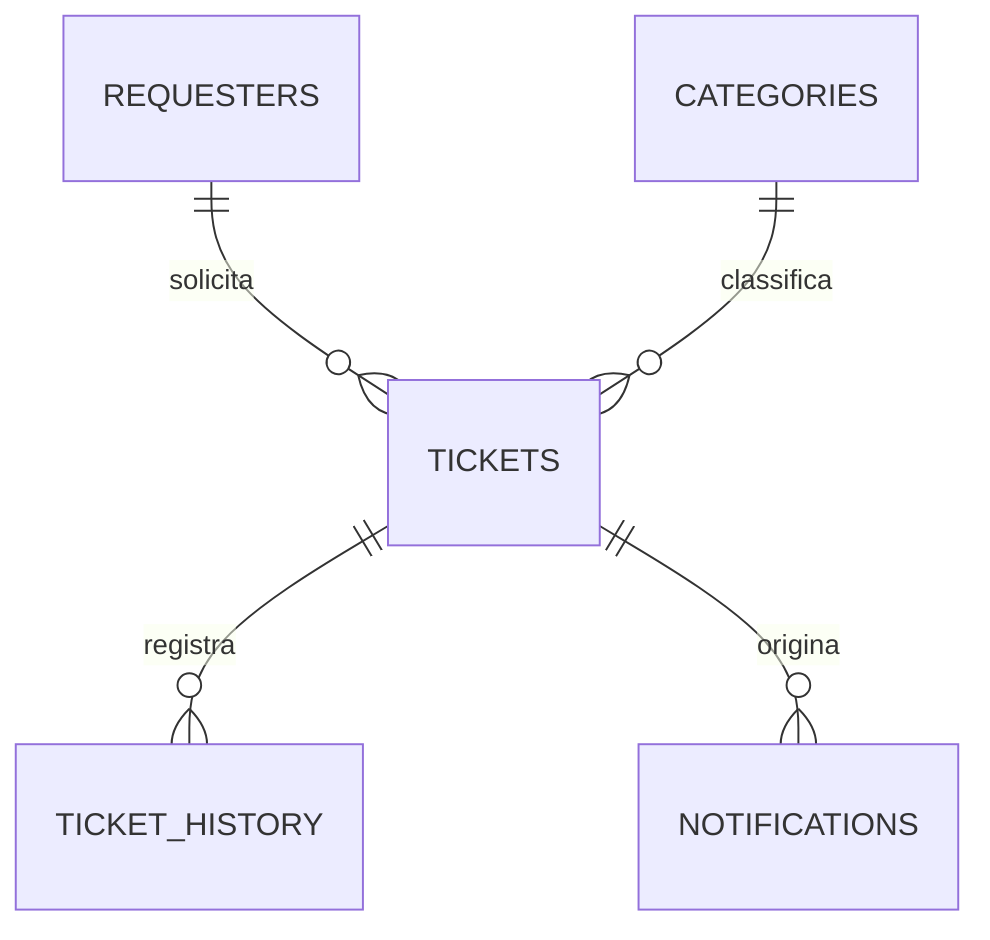

# HelpDesk Hub — Central Inteligente de Chamados de TI

Projeto final da disciplina C216 — Sistemas Distribuídos. O HelpDesk Hub registra solicitações de suporte de TI e pode avisar a equipe por e-mail e Microsoft Teams quando um chamado é aberto.

Na Etapa 6, o navegador carrega a interface React pelo Nginx e usa a mesma origem para acessar `/api/*`. O Nginx encaminha essas requisições ao FastAPI em `api:8000` pela rede interna do Compose. A API lê e grava chamados, histórico e notificações no PostgreSQL em `db:5432`. Rotas como `/tickets/1` abrem diretamente e continuam funcionando após recarregar a página. O navegador guarda apenas preferências de tema e menu.

O ambiente padrão contém `web`, `api` e `db`. Os canais de entrega começam desativados. O perfil de demonstração acrescenta uma caixa SMTP local (Mailpit) e um receptor HTTP de Adaptive Cards.

## Executar com Docker no PowerShell

Use o Docker Desktop em modo de containers Linux e o Docker Compose com suporte a `up --wait`. Na raiz do repositório:

```powershell
if (!(Test-Path .env)) { Copy-Item .env.example .env }
docker compose up -d --build --wait
docker compose ps
Invoke-RestMethod http://127.0.0.1:8001/health
```

| Serviço | Endereço padrão | O que verificar |
| --- | --- | --- |
| React | [Página inicial](http://127.0.0.1:5180) | Dashboard com indicadores e acesso a chamados, cadastros e notificações |
| FastAPI | [GET /health](http://127.0.0.1:8001/health) | HTTP 200 com `{"status":"ok"}`, que indica que a API responde |
| OpenAPI | [Documentação interativa](http://127.0.0.1:8001/docs) | Endpoints, parâmetros e exemplos de requisições e respostas |
| PostgreSQL 16 | `127.0.0.1:5433` | Banco `helpdesk` inicialmente vazio, com dados persistidos em volume |

O Compose usa o nome de projeto `helpdesk-hub` e o volume `db_data` desse projeto. O banco sinaliza prontidão com `pg_isready`. A API conecta-se a `db:5432` e executa `alembic upgrade head` antes de iniciar o Uvicorn. A API fica pronta quando `GET /ready` consegue consultar o banco. O Compose aguarda essa resposta para iniciar o Nginx. O healthcheck do frontend verifica tanto a página quanto o proxy em `/api/ready`. Uma falha na migração interrompe a inicialização antes do Uvicorn.

Para parar a aplicação preservando o volume, execute `docker compose down`.

## API de chamados

| Recurso | Operações |
| --- | --- |
| `/requesters`, `/categories` | `POST` cadastra e `GET` pesquisa. Em `/{id}`, use `GET` para consultar, `PUT` para substituir e `DELETE` para excluir um registro sem chamados vinculados. |
| `/tickets` | `POST` abre um chamado em `OPEN` e `GET` lista os resultados filtrados. |
| `/tickets/{id}` | `GET` consulta, `PUT` substitui os campos operacionais de um chamado ativo e `DELETE` exclui fisicamente um chamado cancelado, incluindo seu histórico e suas notificações. |
| `/tickets/{id}/status` | `PATCH` aplica uma transição de status. |
| `/tickets/{id}/history`, `/tickets/{id}/notifications` | `GET` consulta o histórico cronológico ou as entregas daquele chamado. |
| `/notifications` | `GET` lista entregas por `channel`, `status` e `ticket_id`, com `page` e `page_size`. |
| `/notifications/{id}/retry` | `POST` aceita uma nova tentativa para uma entrega `FAILED` (202). ID inexistente retorna 404. Entrega pendente, em processamento ou já enviada retorna 409. |
| `/dashboard` | `GET` retorna totais por status, prioridade e categoria, críticos ativos, média de resolução em segundos, os cinco chamados mais recentes e totais por status de notificação. Em banco vazio, as contagens são zero, as listas são vazias e a média é `null`. |

As listagens de cadastros e chamados retornam `items`, `total`, `page` e `page_size`. A primeira página é 1 e o tamanho padrão é 20, com máximo de 100. O parâmetro `q` busca por nome, e-mail ou departamento nos solicitantes, por nome ou descrição nas categorias e por título ou descrição nos chamados.

Em `GET /tickets`, combine `status`, `priority`, `category_id`, `requester_id`, `assignee`, `opened_from` e `opened_to`. As datas exigem fuso e os limites são inclusivos. Use `sort_by` com `opened_at`, `updated_at`, `id`, `title`, `priority` ou `status` e `order=asc|desc`. A ordem padrão é abertura decrescente, com desempate por ID.

| Transição | Regra |
| --- | --- |
| `OPEN → IN_PROGRESS` | Exige um responsável já atribuído ou informado em `assignee`. |
| `IN_PROGRESS → RESOLVED` | Exige `resolution`. A API registra `resolved_at` em UTC. |
| `OPEN → CANCELLED` ou `IN_PROGRESS → CANCELLED` | Encerra o chamado e permite sua exclusão física. |

O `PUT` recebe título, descrição, IDs de solicitante e categoria, prioridade e responsável. Campos de ciclo de vida são exclusivos do fluxo de status. Chamados resolvidos ou cancelados ficam fechados para edição. A abertura e cada mudança efetiva são registradas no histórico. O cabeçalho opcional `X-Changed-By` identifica o autor declarado. A abertura grava chamado, histórico e as duas notificações na mesma transação. Os valores de e-mail são normalizados e a carga de demonstração continua independente desse fluxo.

Consultas e atualizações retornam HTTP 200, criações retornam 201 e exclusões retornam 204. Um recurso inexistente retorna 404. Duplicidades, vínculos que impedem exclusão e transições proibidas retornam 409. Dados inválidos, inclusive responsável ou solução ausentes quando exigidos, retornam 422.

### Exemplo no PowerShell

Com o Compose ativo, execute o exemplo uma vez em um banco de demonstração vazio. Cada chamada usa os IDs retornados pela anterior.

```powershell
$apiPort = if ($env:API_PORT) { $env:API_PORT } else { '8001' }
$api = "http://127.0.0.1:$apiPort"
$json = 'application/json; charset=utf-8'
$pessoa = Invoke-RestMethod "$api/requesters" -Method Post -ContentType $json -Body '{"name":"Pessoa Demo","email":"demo@example.org"}'
$categoria = Invoke-RestMethod "$api/categories" -Method Post -ContentType $json -Body '{"name":"Monitores"}'
$dados = @{ title = 'Monitor apagado'; description = 'Verificar o cabo'; requester_id = $pessoa.id; category_id = $categoria.id; priority = 'HIGH' }
$chamado = Invoke-RestMethod "$api/tickets" -Method Post -ContentType $json -Body ($dados | ConvertTo-Json)
$url = "$api/tickets/$($chamado.id)"
Invoke-RestMethod "$url/notifications"
Invoke-RestMethod "$url/status" -Method Patch -ContentType $json -Body '{"status":"IN_PROGRESS","assignee":"Suporte"}'
Invoke-RestMethod "$url/status" -Method Patch -ContentType $json -Body '{"status":"RESOLVED","resolution":"Cabo substituido"}'
Invoke-RestMethod "$url/history"
Invoke-RestMethod "$api/dashboard"
```

## Notificações automáticas

A abertura grava o chamado, o histórico e duas notificações `PENDING` na mesma transação. Após o commit, um processador por canal no ciclo de vida do FastAPI procura entregas no PostgreSQL. Cada processador reserva uma linha com `FOR UPDATE SKIP LOCKED`, registra a tentativa e libera a transação antes de chamar SMTP ou HTTP. A mensagem usa os dados do chamado no momento de cada tentativa e inclui a data original de abertura. A reserva tem prazo, é renovada durante o envio e só o titular pode registrar o resultado. Depois de uma interrupção, o processador recupera o trabalho persistido quando o canal volta a operar.

| Modo por canal | Resultado |
| --- | --- |
| `DISABLED` | Preserva a fila. Habilitar o canal também processa as pendências anteriores. |
| `MOCK` | Registra a simulação com `delivery_mode=MOCK`. Para Teams, `TEAMS_MOCK_URL` opcional permite inspecionar o cartão em um receptor HTTP local. |
| `LIVE` | Registra `delivery_mode=LIVE` e usa SMTP ou HTTPS. `SENT` indica que o servidor SMTP ou o gatilho do Workflow aceitou a mensagem. |

Consulte `GET /tickets/{id}/notifications` para acompanhar os dois canais. A resposta traz `processing`, `attempt_count`, `last_attempt_at`, `sent_at`, `last_error` e `next_attempt_at`. `delivery_mode` fica nulo até a primeira tentativa e em registros anteriores à migração. O dashboard agrupa por status e inclui as simulações em `SENT`.

Uma falha afeta somente aquela entrega. O chamado permanece aberto e o outro canal segue normalmente. O erro público informa o tipo de falha ou o código HTTP. O intervalo dobra a cada falha, até 24 horas. Ao esgotar o limite, a entrega fica `FAILED` com `next_attempt_at=null`. O reenvio manual abre outro ciclo e preserva a contagem acumulada. SMTP e webhooks não garantem entrega exatamente uma vez. Se o destino aceitar a mensagem e a confirmação se perder, uma nova tentativa poderá duplicá-la.

### Demonstração local no PowerShell

Com o arquivo `.env` criado conforme as instruções acima, execute `make demo`. Sem Make, use `docker compose -f compose.yaml -f compose.demo.yaml --profile demo up -d --build --wait`. O perfil usa o banco do projeto Compose selecionado. Para uma demonstração separada do desenvolvimento, escolha outro projeto e portas livres na sessão do PowerShell **antes** de iniciar:

```powershell
$env:COMPOSE_PROJECT_NAME = 'helpdesk-demo'
$env:POSTGRES_PORT = '15433'
$env:API_PORT = '18001'
$env:WEB_PORT = '15180'
$env:MAILPIT_UI_PORT = '18025'
$env:APP_PUBLIC_URL = 'http://127.0.0.1:15180'
make demo
```

Execute o exemplo de abertura de chamado acima na mesma sessão do PowerShell. Abra a interface do Mailpit em `http://127.0.0.1:18025` (porta padrão `8025`) e selecione a mensagem pelo número do chamado para ver o HTML e o texto. O adaptador faz uma entrega SMTP real a `mailpit:1025` na rede do Compose, usando destinatário fictício. O perfil guarda a caixa do Mailpit no volume `mailpit_data` e o último Adaptive Card aceito pelo simulador em `teams_data`. Ambos pertencem ao projeto Compose da demonstração e sobrevivem à recriação dos containers. Use os comandos abaixo para inspecionar o conteúdo e as tentativas persistidas.

```powershell
$demo = @('-f','compose.yaml','-f','compose.demo.yaml','--profile','demo')
docker compose @demo exec -T teams-mock python -c "from urllib.request import urlopen; print(urlopen('http://127.0.0.1:8080/last').read().decode())"
Invoke-RestMethod "$api/tickets/$($chamado.id)/notifications" | Format-Table channel,status,delivery_mode,attempt_count
```

Para reproduzir a falha, pare o simulador e abra outro chamado com os mesmos cadastros. O e-mail ficará disponível no Mailpit. Consulte a entrega até que o Teams chegue a `FAILED` com `next_attempt_at` nulo.

```powershell
docker compose @demo stop teams-mock
$chamado = Invoke-RestMethod "$api/tickets" -Method Post -ContentType $json -Body ($dados | ConvertTo-Json)
$consulta = "$api/notifications?channel=TEAMS&ticket_id=$($chamado.id)"
(Invoke-RestMethod $consulta).items | Format-Table id,status,attempt_count,next_attempt_at
```

Use o ID da **notificação** com falha para o reenvio:

```powershell
$idDaNotificacao = (Invoke-RestMethod $consulta).items[0].id
docker compose @demo start teams-mock
Invoke-RestMethod "$api/notifications/$idDaNotificacao/retry" -Method Post
Invoke-RestMethod "$api/notifications?channel=TEAMS&ticket_id=$($chamado.id)"
docker compose @demo restart api
```

Na central **Notificações**, filtre pelo ID do chamado. A entrega do e-mail deve aparecer como **Enviada** e a do Teams como **Simulação concluída**. Como alternativa ao POST de reenvio do exemplo, religue o simulador, use **Solicitar nova tentativa** na entrega com falha e confirme. **Atualizar** consulta os estados atuais. Consulte a entrega novamente após o reinício. Encerre com `make demo-down` e feche a sessão de demonstração para descartar as variáveis temporárias. O comando preserva os volumes do projeto.

### Configuração para um Teams Workflows autorizado

Em um tenant autorizado, crie um Workflow com o gatilho **When a Teams webhook request is received**, configure a ação para publicar o Adaptive Card no chat ou canal escolhido e salve o fluxo. Defina um coproprietário para continuidade operacional. Consulte o administrador quando as políticas do tenant exigirem aprovação para o aplicativo Workflows, a criação do fluxo ou o modo de autenticação. [Documentação do gatilho](https://learn.microsoft.com/en-us/connectors/teams/#when-a-teams-webhook-request-is-received)

O adaptador implementa POST HTTPS para o gatilho configurado com autenticação **Anyone**, cuja URL completa funciona como segredo. Fluxos restritos a usuários do tenant exigem autenticação adicional com token. Use o modo LIVE somente onde o gatilho e a política permitirem esse tipo de chamada. Injete a URL privadamente em `TEAMS_WEBHOOK_URL`, configure `APP_PUBLIC_URL` com a base acessível aos destinatários, selecione `TEAMS_MODE=LIVE` e recrie a API. O cartão contém o link `/tickets/{id}` para a página do chamado no frontend. A demonstração local confirma o formato e o transporte do cartão. A publicação em Teams depende da execução do fluxo no tenant. [Configuração oficial do Workflows](https://learn.microsoft.com/en-us/microsoftteams/platform/webhooks-and-connectors/how-to/add-incoming-webhook)

## Modelo relacional



Todas as tabelas têm chave primária inteira `id`. As chaves estrangeiras são obrigatórias.

| Tabela | Dados e restrições |
| --- | --- |
| `requesters` | Nome e e-mail obrigatórios, departamento opcional, criação e atualização. Um índice único compara o e-mail em minúsculas, desconsiderando espaços externos. |
| `categories` | Nome obrigatório e único, descrição opcional, criação e atualização. |
| `tickets` | Título, descrição, solicitante e categoria obrigatórios. Prioridade inicial `MEDIUM`, status inicial `OPEN`, abertura e atualização automáticas. Responsável, descrição da resolução e data de resolução começam nulos. |
| `ticket_history` | Chamado, campo alterado, valor anterior, novo valor, autor opcional e data da alteração. Os valores aceitam nulo para representar campos opcionais que foram preenchidos ou limpos. |
| `notifications` | Chamado, canal, destinatário lógico, status, tentativas, último erro, criação, última tentativa e envio. A chave única é `(ticket_id, channel, recipient)`. |

O PostgreSQL valida os enums de prioridade (`LOW`, `MEDIUM`, `HIGH`, `CRITICAL`), status do chamado (`OPEN`, `IN_PROGRESS`, `RESOLVED`, `CANCELLED`), canal (`EMAIL`, `TEAMS`) e status de notificação (`PENDING`, `SENT`, `FAILED`).

**Datas.** As colunas usam `TIMESTAMP WITH TIME ZONE`. O PostgreSQL armazena o instante em UTC e o apresenta no fuso da sessão. O banco preenche as datas iniciais e atualiza `updated_at` de solicitantes, categorias e chamados por trigger, inclusive em alterações por SQL direto.

**Exclusão.** O banco rejeita a exclusão de um solicitante ou categoria com chamados vinculados (`ON DELETE RESTRICT`). Excluir fisicamente um chamado também exclui seu histórico e suas notificações (`ON DELETE CASCADE`). Para preservar o histórico de um chamado encerrado, use o status de resolução ou cancelamento. Há índices para os chamados por solicitante e categoria e para o histórico por chamado e data.

**Tentativas de notificação.** Uma entrega começa pendente, com zero tentativas. Cada tentativa atualiza a mesma linha, incrementa o contador e registra a data. `FAILED` exige uma tentativa e admite uma mensagem de erro sanitizada. `SENT` exige tentativa e data de envio. O índice por status e última tentativa prepara a consulta de entregas pendentes ou com falha. O destinatário é um alias como `solicitante` ou `suporte-ti`, iniciado por letra minúscula e composto por letras minúsculas, números, ponto, sublinhado ou hífen. Credenciais e URLs de entrega pertencem à configuração externa. As mensagens de erro devem conter apenas a descrição pública da falha.

## Migração e dados de demonstração

A revisão inicial `0001_helpdesk` cria as cinco tabelas, os quatro enums e os triggers de atualização. A revisão `0002_delivery` acrescenta o modo da última tentativa, a reserva com prazo de expiração, a contagem por ciclo e o agendamento indexado das próximas tentativas. Com o Compose em execução, use:

```powershell
make migrate
make migration-current
docker compose exec api alembic check
```

O resultado esperado de `make migration-current` é `0002_delivery (head)`. Sem Make, use `docker compose exec api alembic upgrade head` e `docker compose exec api alembic current`. Na suíte isolada, `downgrade base` remove as cinco tabelas, seus registros, tipos e triggers. O teste reaplica o upgrade e compara a estrutura com os modelos.

Para popular o banco de desenvolvimento por escolha explícita, execute:

```powershell
make seed-demo
```

O comando equivalente é `docker compose exec api python -m app.database.seed`. Em banco vazio, uma transação insere seis categorias, dois solicitantes com e-mails em `example.invalid` e quatro chamados que cobrem todas as prioridades e status. A carga identifica as categorias pelo nome, os solicitantes pelo e-mail e os chamados pelos IDs de demonstração `-1` a `-4`. Os IDs automáticos seguem a sequência positiva. Repetir a carga preserva registros e edições existentes. Sua execução gera zero notificações.

## Estrutura

```text
backend/
  app/
    main.py             Aplicação FastAPI
    routers/            Rotas HTTP, incluindo GET /health
    schemas/            Contratos Pydantic
    services/           Regras de negócio
    repositories/       Acesso aos dados de domínio
    models/             Entidades SQLAlchemy, relacionamentos e enums
    database/           Base declarativa, conexão e carga opcional de demonstração
  migrations/           Ambiente e revisões do Alembic
  tests/                Testes Pytest
  alembic.ini
  pyproject.toml        Dependências Python e configuração do Ruff
  poetry.lock
  Dockerfile
frontend/
  src/                  Dashboard, chamados, cadastros e notificações em React
  tests/unit/           Vitest e React Testing Library
  tests/e2e/            Playwright em Chromium desktop e celular emulado
  package.json
  package-lock.json
  Dockerfile
compose.yaml            Serviços web, api, db e Mailpit opcional
compose.demo.yaml       Configuração de SMTP local e receptor HTTP simulado
.env.example            Parâmetros de desenvolvimento
Makefile                Instalação, execução e verificações
.github/workflows/      CI no GitHub Actions
```

## Diagnóstico no PowerShell

- Se o Docker informar que o motor Linux está inacessível, inicie o Docker Desktop e aguarde o estado *Running*. Use `make ps` para conferir quais serviços estão saudáveis.
- Se a API falhar ao subir ou a interface indicar serviço indisponível, consulte `make logs`, verifique as credenciais do volume selecionado e compare `/health` na API com `/api/ready` na origem do frontend. Após recuperar o serviço, use **Tentar novamente** na página.
- Em caso de porta ocupada, escolha valores livres para `WEB_PORT`, `API_PORT` e `POSTGRES_PORT` na sessão PowerShell. Para testar com banco vazio, escolha também um novo `COMPOSE_PROJECT_NAME`. O Compose cria um volume para esse projeto.
- Se `npm ci` falhar com `EPERM` ao substituir um módulo nativo no Windows, encerre o Vite deste projeto antes de executar `make install` novamente.

## Configuração local

O Compose e o Alembic local usam o `.env` da raiz. Os valores de `.env.example` são fictícios. Use as mesmas credenciais do banco já inicializado ao reutilizar seu volume.

| Variável | Finalidade | Exemplo |
| --- | --- | --- |
| `POSTGRES_DB`, `POSTGRES_USER` | Nome do banco e do usuário | `helpdesk` |
| `POSTGRES_PASSWORD` | Senha local do banco | Valor fictício em `.env.example` |
| `POSTGRES_HOST` | Host usado pelo Alembic | `127.0.0.1` no host, `db` no Compose |
| `POSTGRES_PORT` | Porta publicada do banco e porta usada pelo Alembic no host | `5433` |
| `API_PORT`, `WEB_PORT` | Portas publicadas pelo Compose para API e interface | `8001`, `5180` |
| `CORS_ORIGINS` | Origens explícitas, separadas por vírgula, para acesso direto à API | Por padrão, HTTP em `127.0.0.1` e `localhost` na porta do frontend |
| `NOTIFY_EMAIL_RECIPIENT`, `NOTIFY_TEAMS_RECIPIENT` | Aliases lógicos da equipe de TI usados ao abrir um chamado | `suporte-ti` nos dois canais |

| Configuração de entrega | Uso |
| --- | --- |
| `EMAIL_MODE`, `TEAMS_MODE` | `DISABLED`, `MOCK` ou `LIVE` de forma independente. |
| `SMTP_HOST`, `SMTP_PORT`, `SMTP_FROM`, `SMTP_TO` | Servidor, porta, remetente e destinatário da equipe. |
| `SMTP_USERNAME`, `SMTP_PASSWORD` | Credenciais opcionais, configuradas em conjunto. |
| `SMTP_USE_TLS`, `SMTP_USE_SSL` | STARTTLS ou TLS implícito, respectivamente. Ative no máximo um deles. |
| `SMTP_TIMEOUT`, `TEAMS_TIMEOUT` | Timeout das operações de rede em segundos. Padrão de 10 para ambos. |
| `TEAMS_WEBHOOK_URL`, `TEAMS_MOCK_URL` | Segredo HTTPS para LIVE e receptor HTTP local opcional para MOCK, respectivamente. |
| `APP_PUBLIC_URL`, `MAILPIT_UI_PORT` | Base pública para abrir chamados e porta de loopback da caixa de demonstração. |
| `NOTIFY_MAX_ATTEMPTS`, `NOTIFY_RETRY_SECONDS` | Até 3 tentativas por ciclo e intervalo inicial de 10 segundos por padrão. |
| `NOTIFY_POLL_SECONDS`, `NOTIFY_LEASE_SECONDS` | Intervalo de consulta e prazo renovável da reserva. Padrões de 1 e 60 segundos. |

## Desenvolvimento, testes e build

Para executar as ferramentas no host, use Python 3.10 ou 3.12, Poetry 2.4, Node.js 24 com npm e GNU Make. A imagem do backend e a CI usam Python 3.12. A instalação é reproduzível pelos lockfiles de cada projeto.

```powershell
make install
make browser
make lint
make test
make build
```

| Comando | Resultado |
| --- | --- |
| `make install` | Instala as dependências com Poetry e `npm ci` |
| `make api`, `make web` | Inicia a API ou o Vite no host com recarga automática |
| `make unit` | Executa Pytest (saúde e persistência) e Vitest com Testing Library |
| `make test-db` | Verifica o modelo, a migração e a carga de demonstração em PostgreSQL isolado |
| `make migrate`, `make migration-current`, `make seed-demo` | Aplica as migrações, consulta a revisão ou carrega exemplos no ambiente Compose ativo |
| `make browser`, `make e2e` | Instala Chromium ou executa o Playwright |
| `make test` | Agrega os testes de backend, frontend e navegador |
| `make lint` | Verifica lint e formatação com Ruff e Biome |
| `make build` | Gera o build do frontend em `frontend/dist/` |
| `make up`, `make ps`, `make logs`, `make down` | Constrói e aguarda a pilha, mostra o estado, consulta as últimas 100 linhas de cada serviço ou encerra os containers |
| `make demo`, `make demo-down` | Inicia ou encerra a pilha com Mailpit e simulador Teams no projeto Compose selecionado |

Para desenvolver no host, use dois terminais para `make api` e `make web`. Escolha entre esses servidores e os containers que ocupam as mesmas portas. Para subir somente o banco, execute `docker compose up -d db`. O Vite encaminha `/api` à API no host. Se usar uma porta de API diferente de 8001 no desenvolvimento nativo, exporte `$env:API_PORT` com a mesma porta nas duas sessões. No desenvolvimento local, aplique as migrações com `poetry -C backend run alembic upgrade head` antes de abrir a interface.

`make e2e` cria um projeto Compose exclusivo em portas locais aleatórias e aguarda os healthchecks. O Chromium usa a imagem de produção do frontend e a API real. A suíte cria registros próprios, percorre o ciclo do chamado, recarrega páginas internas e verifica os dados persistidos. Ao terminar, encerra seu projeto temporário e remove seu volume de testes. Para inspecionar os dados após os testes, defina `E2E_BASE_URL` com a URL de um **ambiente isolado de validação** já iniciado. Nesse modo a suíte usa esse ambiente e deixa seus registros disponíveis.

Os testes de persistência exigem Docker em execução. O próprio Pytest cria um PostgreSQL 16 em `tmpfs`, publicado em porta aleatória de loopback. A conexão de testes é montada a partir desse container, independentemente do `.env`. Os testes de dados usam transações revertidas. Ao finalizar, a suíte encerra apenas o container que criou. A suíte de entrega sobe um Mailpit descartável e um simulador HTTP em portas aleatórias de loopback. Ela confere a caixa de entrada, o conteúdo do cartão, uma falha HTTP 503, o reenvio e a persistência após reiniciar o Uvicorn. Os canais permanecem desativados nos demais testes, salvo simulação explícita. O GitHub Actions usa o mesmo mecanismo. Com as imagens e dependências já instaladas, os testes executam localmente.

O teste de fluxo HTTP cria um banco próprio nesse PostgreSQL, inicia a API com Uvicorn, percorre a abertura, o atendimento e a resolução, e consulta os dados após reiniciar a API. Os testes de falha verificam o rollback do chamado, do histórico e das notificações.

Sem Make, os comandos equivalentes de validação no PowerShell são:

```powershell
poetry -C backend install --no-root
npm.cmd --prefix frontend ci
poetry -C backend run ruff check .
poetry -C backend run ruff format --check .
poetry -C backend run pytest
npm.cmd --prefix frontend run lint
npm.cmd --prefix frontend test
npm.cmd --prefix frontend run test:e2e:install
npm.cmd --prefix frontend run test:e2e
npm.cmd --prefix frontend run build
```

O workflow do GitHub Actions verifica backend e frontend em jobs separados nos pushes e PRs destinados a `projeto-final`, além do disparo manual. A publicação da aplicação fica para uma etapa posterior.
